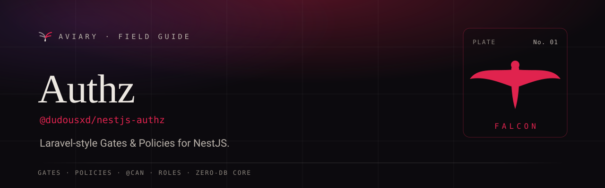

<p align="center">
  <a href="https://davidecarvalho.github.io/aviary/docs/authz">
    
  </a>
</p>

<p align="center">
  <b><a href="https://davidecarvalho.github.io/aviary/docs/authz">📖 Read the documentation</a></b>
  &nbsp;·&nbsp; part of the <a href="https://davidecarvalho.github.io/aviary/"><b>Aviary</b></a> ecosystem for NestJS
</p>

---

# `@dudousxd/nestjs-authz`

Extras on top of NestJS's first-party [`@nestjs/authorization`](https://docs.nestjs.com/security/authorization).
Policies, `@Can()`, the global deny-by-default guard and `AuthorizationService` come from the
official package: read its docs first. This package adds what it does not have:

- **Persisted RBAC as official policies**: `RolePolicy` and `PermissionPolicy` (wildcards,
  tenant-scoped roles, direct permissions, role sources), backed by the TypeORM / MikroORM /
  Prisma / Drizzle adapters, fetched once per request.
- **Helpers for the official `@Can()`**: `byId(Post)`, `roles(...)`, `permission(...)`,
  `ability(...)`, `staticCanArgs(...)`; sugar `@Roles(...)` / `@Permission(...)`.
- **A global super-admin** and an **external policy engine** (Cerbos, OPA, …): extend
  `AuthzPolicy`.
- **A `Gate`** for services: string abilities, batches (`allowsMany`), ad-hoc gates
  (`define`), roles, query scopes (`scope` + the adapters' `applyScope`).
- **Frontend and tooling**: Inertia props, a typed `can()` from codegen, client/React
  helpers, test helpers, and an allow + deny decision event for Telescope.

See [`DESIGN.md`](./DESIGN.md) for the design and the trade-offs.

## Install

```sh
pnpm add @nestjs/authorization @dudousxd/nestjs-authz
```

Requires NestJS 12 and Node 24+. Two optional peers: `@nestjs/authentication` gives the `Gate`
its ambient user (`AuthenticationContext.user`); `@dudousxd/nestjs-context` gives it one too
(outside an authentication scope), plus the per-request permission cache and
tenant-scoped roles.

```ts
@Module({
  imports: [
    AuthorizationModule.forRoot(),                        // official: guard, @Can, AuthorizationService
    AuthzModule.forRoot({ superAdmin: (user) => user?.isRoot === true }),
  ],
  providers: [PostPolicy],
})
export class AppModule {}
```

## Policies (official) + `@PolicyFor`

```ts
import { Can, Policy } from '@nestjs/authorization';
import { AuthzPolicy, PolicyFor, authorizedResource, byId } from '@dudousxd/nestjs-authz';

@Policy()
@PolicyFor(Post)                       // optional: links Post → PostPolicy for the extras
export class PostPolicy extends AuthzPolicy {   // optional: honors `superAdmin`
  update(user: User | null, post: Post) {
    return post.authorId === user?.id;
  }
}

@Controller('posts')
export class PostController {
  @Patch(':id')
  @Can(PostPolicy, 'update', byId(Post))   // byId loads the Post named by :id
  update(@Req() req: Request) {
    const post = authorizedResource(req, Post); // the record byId loaded, no second query
  }
}
```

`byId` uses the `ResourceResolver` given to `AuthzModule.forRoot({ resourceResolver })`
(default: an `{ id }` object from the route param; `idParam` renames it, `byId(Post, { param })`
per route). A record that is not found is a 403 before the policy runs.

`@PolicyFor(Post)` is what lets the extras go from a resource to its policy:
`gate.allows('update', post)`, `gate.scope(Post)`, the client ability map. The official API
never needs it, and `@PolicyFor` applies the official `@Policy()` itself.

## Roles and permissions

```ts
@Roles('admin', 'editor')                                  // any of
@Can(RolePolicy, 'hasAll', roles('admin', 'editor'))      // all of
@Permission('posts.publish')                              // any of; posts.* grants it
@Can(PermissionPolicy, 'hasAll', permission('posts.publish', 'posts.delete'))
```

Roles come from `user.roles` / `user.role` (or `resolveRoles`) and from the RBAC adapter's role
store; permissions from the adapter:

```ts
AuthzRbacModule.forRootAsync({
  inject: [DataSource],
  useFactory: (ds: DataSource) => ({ store: new TypeOrmAuthzStore(ds) }),
});
```

Within one request (a nestjs-context store), a user's permissions and the adapter's roles are
fetched once, however many checks run: the official guard's `RolePolicy` / `PermissionPolicy`
and the handler's `Gate` calls share the fetch. The entry is keyed by the row the user names
(its class or `type`, plus `id`); a plain object without `type` is keyed by identity. A grant
made mid-request applies from the next request. Adapters set `exhaustivePermissions`, so a
permission the set lacks is answered without another query.

`roles()`, `permission()`, `ability()` and `staticCanArgs()` return resolvers whose arguments do
not depend on the call. They carry them on a non-enumerable `Symbol.for('@dudousxd/static-can-args')`
property, so tools such as the Aviary agent can evaluate a requirement without a request.

## Super-admin

The official guard runs only each policy's own `before()`. Extend `AuthzPolicy` (or call
`superAdminBefore(user, ability, resource)` from your `before()`) and the `superAdmin` hook
grants every ability of that policy. The hook receives the resource (the ability's first
argument), so it can scope the bypass. `RolePolicy` and `PermissionPolicy` extend it.

## The `Gate`

```ts
constructor(private readonly gate: Gate) {}

await this.gate.forUser(user).authorize(PostPolicy, 'update', post); // = AuthorizationService.authorize
await this.gate.forUser(user).allows('update', post);                // the policy linked to Post
await this.gate.forUser(user).allows('posts.publish');               // a persisted permission

this.gate.define('access-admin', (user) => user.isStaff);
// on a route: @Can(GatePolicy, 'allows', ability('access-admin'))

const results = await this.gate.forUser(user).allowsMany([
  { ability: 'update', resource: post },
  { policy: ReportPolicy, ability: 'export', args: ['csv'] },
]);                                                                  // one permission fetch

const where = await this.gate.forUser(user).scope(Post);            // from PostPolicy.scope(user)
```

String abilities ask `superAdmin`, then the external decision point (below), then the policy
linked to the resource, then the persisted permissions, then the ad-hoc gate. **The policy has
the final word**: holding a permission named like one of its abilities (`update`) does not
bypass it; only `superAdmin` does. Permissions grant the named abilities no policy defines
(`posts.publish`). The same goes for `scope()`: a permission scopes an entity only when no
policy method can.

Policy decisions are always the official service's. `authorize()` throws the official
`AuthorizationError`, which the official module turns into a 401/403.

Without `forUser`, the user is, in order:

1. `@nestjs/authentication`'s `AuthenticationContext.user`, when that optional peer is
   installed and its module imported (found through Nest's `ModuleRef`), and its scope is active:
   a call it handles, or `AuthenticationContext.run()`. Its answer is final there: `null` is a
   guest, and nestjs-context is not asked. It is `AsyncLocalStorage`-backed, correct in handlers
   and everything they await;
2. outside any authentication scope (a queue worker, a cron job, or without the package),
   nestjs-context's user ref, hydrated by `resolveUser` (once per request) when configured;
3. a guest (`null`).

## Decisions

Every `Gate` check and every requirement the official guard enforced is published, allowed or
denied, on the `aviary:authz:decision` diagnostics channel (`authzDecisionChannel`). The official
package publishes denials only, on `nestjs:authorization:denied`.

## Migrating from 0.8

0.8 and earlier had their own engine. 0.9 runs on `@nestjs/authorization`, and the old
decorators are gone: move each one to its official form.

| 0.8 | 0.9 |
| --- | --- |
| `@Policy(Post)` | `@Policy()` from `@nestjs/authorization` + `@PolicyFor(Post)` (or `@PolicyFor(Post)` alone) |
| `@Can('update', Post)` | `@Can(PostPolicy, 'update', byId(Post))`, `@Can` from `@nestjs/authorization` |
| `@Can('create', Post, { classLevel: true })` | `@Can(PostPolicy, 'create')` |
| `@Can('access-admin')` | `@Can(GatePolicy, 'allows', ability('access-admin'))` |
| `@Roles('admin')` + `RolesGuard` | `@Roles('admin')`, enforced by the official guard |
| `CanGuard`, `RolesGuard`, `PolicyRegistry` | removed: the official `AuthorizationGuard`; `PolicyIndex` |
| `AuthzModule.forRoot({ policies })` | register policies as providers (or `AuthorizationModule.forRoot({ policies })`) |
| `superAdmin` applied everywhere | applied by `AuthzPolicy` subclasses, the built-in policies and the `Gate` |
| `after` hook, `{ allowed, message }` results | removed: only a literal `true` allows |
| current user from nestjs-context on routes | the official `getUser` (default `request.user`) |
| `gate.allows()` user from nestjs-context | `AuthenticationContext.user` inside its scope (`null` there is a guest), nestjs-context outside it |
| a persisted permission named like a policy ability grants it | the policy decides (only `superAdmin` bypasses it), in checks and in `scope()` |
| `DecisionProvider` / `superAdmin` see a guest as `undefined` | `null` |
| a `DecisionProvider` deny `message` (`{ allowed: false, message }`) is the 403's message | dropped: the 403 is the official `{ statusCode: 403, message: 'Forbidden' }`. `@nestjs/authorization` has no deny-with-reason (a policy returns `true` or denies; an exception it throws counts as a failure, not a denial). To show a reason, throw your own `ForbiddenException(reason)` from the ability. A route then gets your body, but no `denied` event is emitted and `AuthorizationService.can()` throws instead of returning `false`. |
| `DecisionProvider` asked by the Gate on every check | asked by `AuthzPolicy.before()` on routes, and by `Gate` string abilities |
| `import … from '@dudousxd/nestjs-authz-inertia/client'` | `import … from '@dudousxd/nestjs-authz-client'` (the subpath is removed) |

Behavior the official guard brings:

- **Deny by default.** A handler with no `@Can()` is denied; add `@Can.Anyone()` (or
  `@Public()` from `@nestjs/authentication`) where anyone may call it.
- **Class and method requirements add up.** A class-level `@Roles` no longer gives way to the
  method's.
- **Guests reach the policy as `null`.** Type the user `User | null`; a guest denial is a 401.

### Migrating one controller at a time: `unannotated: 'allow'`

The official guard denies every route that declares no `@Can()`: the app's public routes, and
every controller another library mounts. 0.8 let them through. Turning authorization on for a
large app in one go is rarely possible, so this package has a migration mode (the official guard
has no such option):

1. **Turn the official global guard off**, and switch the migration mode on:

   ```ts
   imports: [
     AuthenticationModule.forRoot({ ... }),                 // or your Passport guard, first
     AuthorizationModule.forRoot({ globalGuard: false }),
     AuthzModule.forRoot({ unannotated: 'allow' }),         // forRootAsync: next to useFactory
   ]
   ```

   `AuthzModule` registers its own global `AuthzGuard`. A route with official `@Can()`
   requirements (class or method, `@Roles`, `@Permission`) is handed
   to the official `AuthorizationGuard` as is: same `getUser`, same policies, same 401 for a guest
   and 403 for a user, same `denied` event. A route with no requirement is let through. The app
   fails to start if the official global guard is still on, because it would keep denying them.

   **The boot log has one expected ERROR in this mode.** `@nestjs/authorization` 0.1.3 checks at
   startup that a guard enforces each `@Can()`, and it recognizes only its own
   `AuthorizationGuard` (by a static brand). It does not see `AuthzGuard`, so it logs:

   ```text
   ERROR [Authorization] @Can() is not enforced on PostController.update, … : AuthorizationModule has
   globalGuard: false, and these handlers have no @UseGuards(AuthorizationGuard).
   ```

   That is safe: `AuthzGuard` enforces those handlers. `AuthzModule` logs a line right after it,
   naming the same handlers. `AuthzGuard` does not carry the brand on purpose: with it, the
   official check would log every route this mode lets through as "AuthorizationGuard denies every
   call to …", which is also false. The error goes away at step 4.

2. **Drop the 0.8 guard and move the old decorators.** Remove `RolesGuard` / `CanGuard` from
   `APP_GUARD` and `@UseGuards()`, and rewrite each string `@Can` / `@Policy(Post)` with the table
   above (`@Can('page.documents')` → `@Can(GatePolicy, 'allows', ability('page.documents'))`).
   `@Roles('admin')` and `@Permission(...)` are unchanged. All of them are enforced by `AuthzGuard`.

3. **Annotate the open routes**, one controller at a time: `@Can.Anyone()` where anyone may call
   it, `@Public()` (from `@nestjs/authentication`) where no sign-in is needed, a `@Can(...)`
   everywhere else.

4. **Switch to deny by default** when every route declares something: remove `unannotated` (or set
   `'deny'`) and `globalGuard: false`. The official guard is global again, and a forgotten
   `@Can()` is a 403 instead of an open route.

A route that slipped through in step 3 is open in this mode, so keep it for the migration only.

## External policy engines (Cerbos, OPA, …)

Register a `DecisionProvider` under `DECISION_PROVIDER` to hand decisions to an external policy
decision point. Unlike the grant-only RBAC seam, it can **allow or deny** a resource-aware check.
Returning `undefined` abstains. The provider can also batch `gate.allowsMany`, and it can map the
engine's query plan onto `gate.scope()`. It runs right after the `superAdmin` hook:

- on routes, in the `before()` of every policy that extends `AuthzPolicy`, with the ability and
  its first argument (`byId(Post)`'s record). `RolePolicy` and `PermissionPolicy` do not ask it:
  their abilities name roles and permissions, not resources. Call `decisionProviderBefore()`
  from your own `before()` when a policy cannot extend `AuthzPolicy`;
- in the `Gate`, before the policy, the permissions and the ad-hoc gate of a string ability.
  `allowsMany` asks `decideMany` once for the batch.

A guest reaches it as `null`. A Cerbos adapter ships in the box as a subpath with no extra
dependency; bring your own `@cerbos/http` or `@cerbos/grpc` client:

```ts
import { DECISION_PROVIDER } from '@dudousxd/nestjs-authz';
import { CerbosDecisionProvider } from '@dudousxd/nestjs-authz/cerbos';
import { HTTP } from '@cerbos/http';

providers: [{
  provide: DECISION_PROVIDER,
  useValue: new CerbosDecisionProvider({
    client: new HTTP(process.env.CERBOS_URL!),            // or (user) => per-tenant client | undefined
    principal: (u) => u && { id: u.id, roles: u.roles, attr: { tenantId: u.tenantId } },
    resource: (ability, r) => (r instanceof Post ? { kind: 'app:post', id: r.id, attr: { ownerId: r.ownerId } } : undefined),
    scope: { resource: (entity) => (entity === Post ? { kind: 'app:post' } : undefined) },
  }),
}]
```

The adapter fails **closed** by default. An unreachable PDP denies, and an unsupported query plan
scopes to no rows. Set `onFailure: 'abstain'` to fall back to your own policies instead.

## Build output check

`tsc` builds run with `--incremental false`. The `.tsbuildinfo` file sits outside `dist/` (and outside
turbo's cached `outputs`), so after `dist/` is removed or restored an incremental build can decide the
outputs are current and emit only some files (seen as a missing `dist/index.js`).

`pnpm check:exports` (also each package's `prepack`, and a CI step after the build) fails if a path in a
package's `exports`, `main`, `module`, `types` or `bin` does not exist. `release` runs it before
`changeset publish`. Run it after any build you are about to pack.

## License

MIT © Davi Carvalho
